# Phase 1 results: PCA spectral compression and multiplication in weight space

Status as of 2026-10-10: **Munsell only.** (Phase 1.5 sections A–C and the project verdict are at the end of this file.) ECOSTRESS/ASTER is not yet supplied (see
`data/README.md`). Every number below was produced by the scripts in `src/` and is
reproducible with the commands in `README.md`. Full tables:
`results/reconstruction.json`, `results/multiplication_tables.md`, `results/multiplication.json`.

## Plain-language summary

* **Compression works well for single spectra.** On 8 *held-out hue pages* of Munsell chips,
  K = 6 gives mean ΔE00 ≈ 0.4–0.6 and K = 8 gives ≈ 0.2. Train and test errors are almost
  identical. This reproduces a well-known result (Parkkinen et al. 1989; Maloney 1986).
* **Multiplying in a linear PCA basis fails quickly.** The K×(K+1)×(K+1) product tensor
  (the Galerkin projection of the product, as in Peercy 1993) is mathematically
  identical to decompress-multiply-recompress when nothing is clamped. I checked
  this numerically: max difference 4e-15. Both break down after **1–2 bounces**.
  The cause is not the operator: a basis fitted to single reflectances cannot represent the
  *darker, more saturated* product spectra. Even the best possible projection of the
  **true** product onto the basis (`raw_floor`) has exposure-normalised ΔE ≈ 5–26 at
  K = 6 for 1–3 bounces. A least-squares-fitted tensor did not help, since it shares that floor.
* **PCA in log-reflectance space removes the problem for products.** There,
  multiplication is *exactly* addition of weights, so error does not compound
  beyond the input representation error. At K = 6, exposure-normalised ΔE stays at 0.7–1.1
  over 1–5 random bounces; at K = 8 it stays at 0.3–0.5. The **catch** is that log-space
  weights are *not* closed under addition (summing radiance contributions) or under
  linear texture filtering, and getting colour out needs an 81-wide `exp` decode.
  This is a real cost and a design problem for Phase 2, not a solved issue.
  Using log/optical density for multiplicative mixing is an old idea; I have **not**
  done a literature search to establish whether log-PCA for spectral rendering
  products is published (it probably is in some form). **Do not treat this as novel yet.**
* **Baselines.** RGB is exact at 0 bounces under D65 by construction, and its error grows
  roughly linearly with bounces: exposure-normalised mean 2.3 at n=1, 6.3 at n=3, 9.9 at n=5.
  A **fixed 4-wavelength quadrature** (450/505/560/615 nm with fitted weights) is a
  surprisingly strong cheap baseline: 1.4 at n=0, growing to 3.1 at n=5. It beats linear PCA
  for any K ≤ 10 once there is a single multiplication. **Stochastic 4-wavelength (hero)
  sampling** is unbiased, so its error doesn't depend on bounce count, but it is noise:
  ΔE ≈ 12.8 with 1 sample, 2.9 with 16 and 0.73 with 256 samples, flat across bounces.
* **At equal state size:** log-PCA K=4 (1.7–2.8 over 1–5 bounces) is about the same as quad4
  (1.7–3.1) and better than RGB beyond n=1. Log-PCA K=6–8 is clearly the most accurate
  deterministic option here, but it costs more per path (see the cost table).

## Data (Step 1)

| dataset | loaded | kept (strict 380–780) | train | test | split unit |
|---|---|---|---|---|---|
| Munsell matt (UEF) | 1269 | 1269 | 1022 (32 hue pages) | 247 (8 hue pages) | Munsell hue page |
| ECOSTRESS | – (not supplied) | – | – | – | material name |

Test hue pages: 2.5GY, 2.5P, 5G, 5RP, 7.5BG, 7.5R, 10B, 10YR (every 5th page round the hue circle).
Munsell reflectance range is 0.030–0.839: there are no near-blacks, near-whites, or out-of-range values.

## PCA (Step 2): cumulative explained variance (train split, own value space)

| space | K=3 | 4 | 5 | 6 | 8 | 10 |
|---|---|---|---|---|---|---|
| raw | 0.9825 | 0.9919 | 0.9957 | 0.9973 | 0.9991 | 0.9997 |
| sqrt | 0.9835 | 0.9924 | 0.9958 | 0.9973 | 0.9992 | 0.9997 |
| logit | 0.9839 | 0.9928 | 0.9958 | 0.9974 | 0.9993 | 0.9997 |
| log | 0.9840 | 0.9927 | 0.9959 | 0.9974 | 0.9992 | 0.9997 |

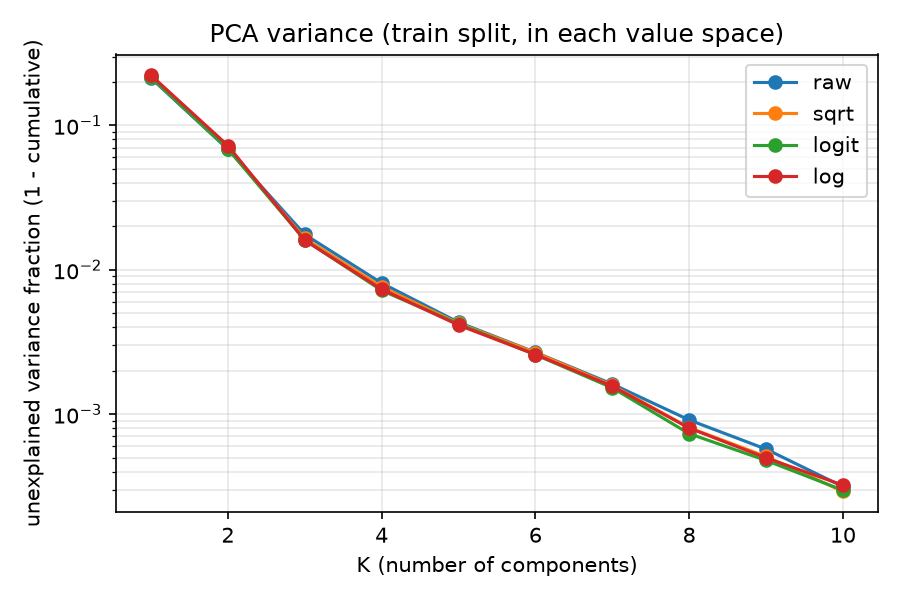

## Reconstruction vs K (Step 3): held-out test split, ΔE00 under D65 / CIE 1931 2°

| space | K | RMSE | ΔE mean | ΔE p95 | ΔE max | decode left [0,1] before clamp |
|---|---|---|---|---|---|---|
| raw | 3 | 0.0212 | 3.51 | 7.90 | 14.61 | 2.0% |
| raw | 4 | 0.0144 | 1.15 | 2.55 | 7.47 | 0.8% |
| raw | 6 | 0.0089 | 0.56 | 1.59 | 3.12 | 0% |
| raw | 8 | 0.0052 | 0.19 | 0.49 | 1.76 | 0% |
| raw | 10 | 0.0031 | 0.12 | 0.27 | 1.10 | 0% |
| sqrt | 6 | 0.0083 | 0.46 | 1.28 | 2.45 | 0% |
| logit | 3 | 0.0203 | 2.86 | 6.11 | 9.43 | n/a (in range by construction) |
| logit | 6 | 0.0080 | 0.38 | 0.94 | 2.54 | n/a |
| logit | 8 | 0.0046 | 0.21 | 0.50 | 2.70 | n/a |
| log | 6 | 0.0091 | 0.59 | 1.75 | 3.75 | 0% |
| log | 8 | 0.0050 | 0.22 | 0.53 | 2.91 | 0% |
| log | 10 | 0.0029 | 0.06 | 0.15 | 0.25 | 0% |

The transformed spaces differ only slightly for single spectra. Logit is marginally best at K=6 and
guarantees [0,1]; raw needs clamping at K ≤ 5. Train vs test mean ΔE (raw): 0.55 vs 0.56 at K=6.

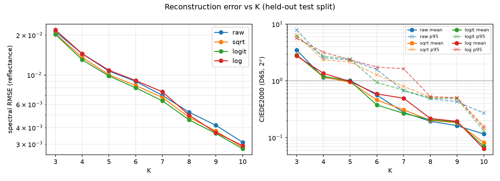

## Multiplication in weight space (Steps 4–5)

*Bounces n* = n multiplications, i.e. the product of n+1 spectra. *Random* = 20 000 chains of
distinct test spectra. *Self* = s^(n+1) for each of the 247 test spectra, a proxy for
inter-reflection inside one coloured material.

**Metric caveat (important).** The median L* of a random product is 57 (n=0), 25 (n=1),
1.9 (n=3) and 0.1 (n=5). Absolute ΔE00 near black is tiny for *any* error, so in the absolute
metric every method appears to *improve* with more bounces. I therefore report primarily an
**exposure-normalised** ΔE00: truth and estimate are scaled by the same factor so the true
Y = 20 (L* ≈ 52). This asks "is the colour right once the image is exposed for this light
path?" It is harsh on methods with an absolute error floor. Absolute numbers are in
`results/multiplication_tables.md`, and both metrics are plotted.

### Random chains, exposure-normalised ΔE00 (mean)

| method | K | n=0 | n=1 | n=2 | n=3 | n=5 |
|---|---|---|---|---|---|---|
| RGB (linear sRGB, unclamped) | – | 0.00 | 2.33 | 4.42 | 6.34 | 9.93 |
| quad4 (fixed 4 λ, fitted weights) | – | 1.36 | 1.74 | 2.11 | 2.46 | 3.12 |
| hero4, 16 spp | – | 3.15 | 2.90 | 2.86 | 2.85 | 2.96 |
| hero4, 256 spp | – | 0.79 | 0.73 | 0.72 | 0.71 | 0.74 |
| raw_floor (projection of TRUE product) | 6 | 0.60 | 5.21 | 13.77 | 25.65 | 64.90 |
| recon_product (decode inputs, exact product) | 6 | 0.60 | 0.88 | 1.08 | 1.26 | 1.57 |
| raw DMR (clamped) | 6 | 0.60 | 5.26 | 14.01 | 26.42 | 67.25 |
| raw tensor (Galerkin) | 4 | 1.22 | 8.63 | 28.39 | 43.57 | 60.29 |
| raw tensor (Galerkin) | 6 | 0.60 | 6.68 | 25.44 | 40.93 | 51.37 |
| raw tensor (Galerkin) | 8 | 0.21 | 2.64 | 10.75 | 27.20 | 85.44 |
| raw tensor (Galerkin) | 10 | 0.12 | 1.55 | 6.98 | 19.07 | 45.87 |
| raw tensor (LS-fitted) | 6 | 0.60 | 6.60 | 24.89 | 40.28 | 49.35 |
| sqrt tensor | 6 | 0.46 | 2.16 | 5.51 | 10.36 | 31.91 |
| sqrt tensor | 10 | 0.08 | 0.73 | 2.00 | 4.93 | 22.78 |
| **log-PCA, add weights** | 4 | 1.34 | 1.72 | 2.04 | 2.30 | 2.76 |
| **log-PCA, add weights** | 6 | 0.57 | 0.73 | 0.85 | 0.96 | 1.13 |
| **log-PCA, add weights** | 8 | 0.22 | 0.29 | 0.35 | 0.40 | 0.49 |
| **log-PCA, add weights** | 10 | 0.06 | 0.08 | 0.10 | 0.11 | 0.14 |

### Self chains (s^(n+1)), absolute ΔE00 (mean). These stay bright enough for the absolute metric to mean something

| method | K | n=0 | n=1 | n=2 | n=3 | n=5 |
|---|---|---|---|---|---|---|
| RGB | – | 0.00 | 2.00 | 2.63 | 2.62 | 2.14 |
| quad4 | – | 1.36 | 1.52 | 1.39 | 1.20 | 0.80 |
| hero4, 256 spp | – | 0.85 | 0.58 | 0.41 | 0.27 | 0.18 |
| raw DMR | 6 | 0.56 | 2.40 | 2.84 | 2.92 | 2.87 |
| raw tensor | 6 | 0.56 | 3.24 | 5.39 | 6.79 | 8.36 |
| raw tensor | 8 | 0.19 | 1.49 | 2.47 | 3.08 | 3.74 |
| sqrt tensor | 6 | 0.46 | 1.34 | 1.65 | 1.68 | 1.47 |
| log-PCA add | 6 | 0.59 | 0.83 | 0.86 | 0.82 | 0.70 |
| log-PCA add | 8 | 0.22 | 0.30 | 0.29 | 0.27 | 0.21 |

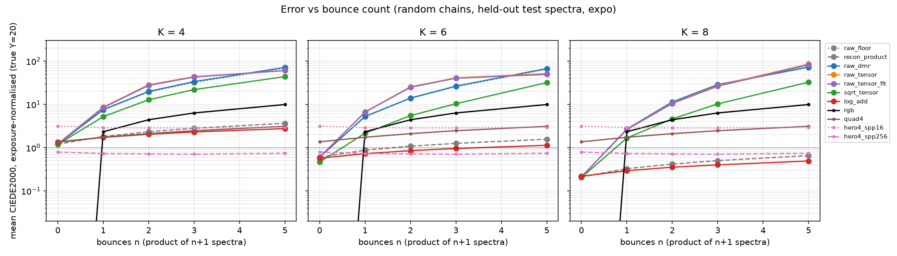
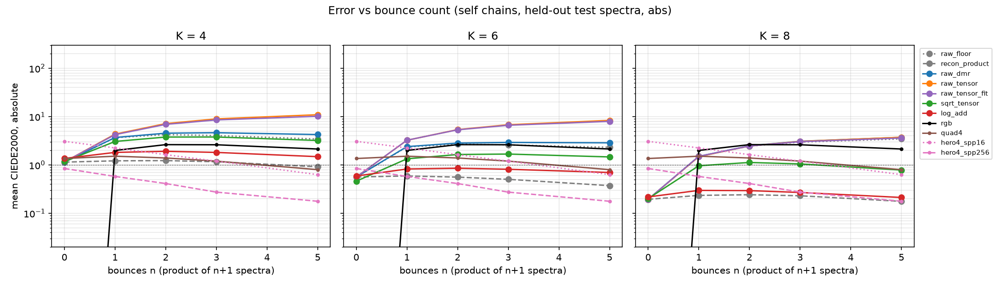
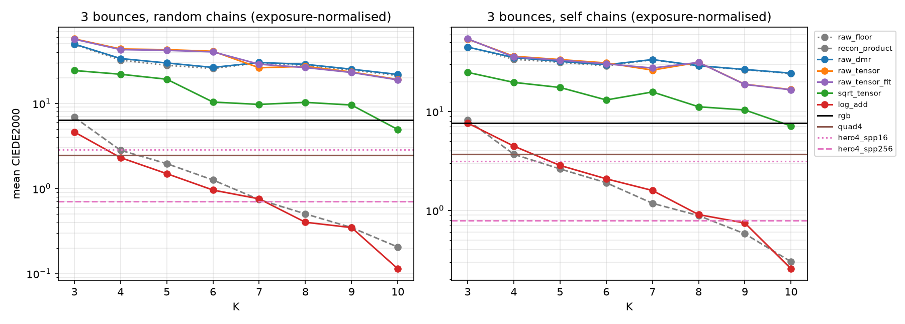

### Where each method breaks down (threshold: mean ΔE00 > 2, exposure-normalised, random chains)

| method | K=4 | K=6 | K=8 | K=10 |
|---|---|---|---|---|
| raw tensor / DMR | n=1 | n=1 | n=1 (2.6) | n=2 |
| sqrt tensor | n=1 | n=1 (2.2) | n=2 | n=2 (2.00, borderline) |
| log-PCA add | n=2 (2.04) | not within n ≤ 5 | not within n ≤ 5 | not within n ≤ 5 |
| RGB | n=1 | | | |
| quad4 | n=2 (2.11) | | | |

### Cost per multiplication (operation counts, not measured GPU timings)

| method | state floats | ALU per multiply | colour readout |
|---|---|---|---|
| RGB | 3 | 3 mul | free |
| quad4 / hero4 | 4 | 4 mul | 4×3 MAC (hero4 also needs per-hit spectral evaluation and many spp) |
| raw tensor | K | K(K+1)² MAC: 100 (K=4), 294 (K=6), 648 (K=8) | 3(K+1) MAC |
| raw DMR | K | ≈ 3·81·K + 81: 1539 (K=6) | 3(K+1) MAC |
| log-PCA add | K (+1 count) | **K adds** | 81·K MAC + 81 exp + 243 MAC per decode |

The log-PCA readout cost recurs at **every point where radiance is added**, such as each
emitter hit or NEE sample in a path tracer, because addition is not closed in log space.

## What worked, what failed, what surprised me

**Worked:** low-K PCA for single spectra; log-space PCA for products; the colorimetry
pipeline (verified against all 34 Sharma pairs and colour-science); export round-trip.

**Failed:** the linear-basis product tensor, and DMR, for more than one bounce. Increasing K
does not reliably help: at n=5, raw tensor K=8 (85) is worse than K=6 (51). Fitting the
tensor by least squares changed almost nothing.

**Surprised me:**
1. The absolute ΔE00 *decreases* with bounce count for every method (dark-colour artefact). Without
   exposure normalisation I would have reported the opposite conclusion.
2. The failure of the linear tensor is a **basis** problem, not an operator problem: `raw_floor` ≈ DMR.
3. A dumb fixed 4-wavelength quadrature beats a K=10 linear PCA tensor after a single bounce.
4. Clamping in DMR helps only slightly compared with the unclamped tensor; it does not fix the floor.

## Limitations

* **Munsell only.** Its spectra are smooth, mid-range (0.03–0.84) and include no neutrals,
  blacks, fluorescents or minerals with sharp absorption features. The ECOSTRESS results may differ a lot.
* **D65 only.** RGB is exact at n=0 under D65 by construction. The main advantage of spectral
  methods (illuminant change, metamerism) has **not** been tested yet.
* Small test set: 247 spectra from 8 hue pages. Random chains reuse them heavily.
* Cost figures are operation counts, not WebGPU measurements.
* The 4-wavelength quadrature was fitted on training singles and products with a 1/(Y+1) weighting heuristic.

## Suggested next steps (need your call)

1. Supply ECOSTRESS, then re-run everything and decide the coverage policy.
2. Test illuminant changes (A, F-series, LED), where RGB should lose clearly.
3. Address log-PCA's addition problem. Options include carrying linear XYZ for accumulated
   radiance and log-PCA only for path throughput (decode once per emission event), or a hybrid.
4. Try a linear basis fitted on *products* or with renormalisation of brightness per bounce.
5. Do a literature search on log-domain spectral bases before claiming anything (see LAB_NOTEBOOK).

## References (standard / prior work, not claimed as ours)

* Parkkinen, Hallikainen & Jääskeläinen (1989), JOSA A 6(2): PCA of Munsell spectra.
* Maloney (1986), JOSA A 3(10): low-dimensional linear models of surface reflectance.
* Peercy (1993), SIGGRAPH: linear colour representations for full spectral rendering (product matrices in a linear basis).
* Wilkie et al. (2014), EGSR: hero wavelength spectral sampling. PBRT-v4 uses 4 stratified wavelengths.
* Meng, Simon, Hanika & Dachsbacher (2015), CGF/EGSR: physically meaningful rendering using tristimulus colours.
* Jakob & Hanika (2019), CGF/EG: a low-dimensional function space for efficient spectral upsampling.
* Peters et al. (2019), TOG/SIGGRAPH: moment-based representation of bounded signals for spectral rendering.
* Sharma, Wu & Dalal (2005), Color Res. Appl. 30(1): CIEDE2000 implementation notes and test data.

---

# Phase 1.5 (2026-10-10): illuminants, a shippable basis, accumulation cost

All numbers come from `src/eval_illuminants.py`, `src/eval_hybrid4.py`, `src/eval_shippable_basis.py`
and `src/bench_accumulation.py`. Test spectra are the same 247 held-out Munsell chips.
**ECOSTRESS is still not supplied** (`data/raw/ecostress/` does not exist).

## What this means for the project (verdict)

**Recommendation: pivot. Don't build the WebGPU renderer around log-PCA yet.**

1. **Your motivation holds for RGB.** Under every non-D65 light, RGB is wrong before any bounce
   (exposure-normalised mean ΔE00 at n=0: A 3.5, F2 4.7, F11 3.2, 610 nm line 8.9,
   neon-like 9.2) and it gets worse with bounces (13–29 at n=5).
2. **Log-PCA is accurate everywhere:** K=6 stays ≤ 1.6 (random chains, n ≤ 5) under all six
   lights, including line spectra. Self-products are worse (≤ 3.1 at n=5).
3. **But a known, cheaper method matches it where it matters most.** Hero-wavelength
   sampling (Wilkie et al. 2014; 4 wavelengths per sample as in PBRT-v4) with a
   **light-aware wavelength pdf** is near-exact under the 610 nm line (0.42 at 1 spp,
   0.10 at 16) and good under neon-like (0.85 at 16 spp). Its path state is the same size
   as log-PCA K=4 (36 vs 32 bytes). Log-PCA needs an 81-wide `exp` decode at every
   emission event, about 25x the FLOPs and 6.4x the CPU time per bounce of hero-4λ.
4. **The shippable basis costs accuracy.** The best licence-safe K=6 basis (GP-synthetic)
   roughly doubles or triples the error of the research-only Munsell basis.
5. **The fixed 4-wavelength quadrature should be dropped.** It collapses under line spectra
   (F11 ≈ 24–30, neon-like 50). Linear PCA stays unusable past one bounce.

The **one regime where log-PCA may still win** is 1–4 spp real-time with a denoiser. There,
hero-4λ colour noise is large (ΔE ≈ 11–12 at 1 spp under broadband light, even light-aware),
while log-PCA K=6 is deterministic at about 0.7–1.4. **That is a hypothesis I haven't measured.**
It needs an equal-frame-time comparison including a denoiser. Suggested next step: a minimal
WebGPU prototype with **hero-4λ + Jakob–Hanika uplift + light-aware wavelength sampling** as
the baseline (all known techniques), with log-PCA K=6 as an optional throughput mode, compared
at 1 spp and denoised. Stop work on linear-PCA products.

## A. Illuminant change and narrow-band light

**Setup.** Ground truth is now computed at **1 nm** (380–780) from native 1 nm Munsell data,
because a 5 nm grid cannot resolve a 5 nm-FWHM line. Lights: CIE D65, A, F2, F11 (official
CIE CSVs, MD5-verified), NB610 (synthetic Gaussian, 610 nm, FWHM 5 nm) and NEONLIKE (14
synthetic lines, 1 nm FWHM, at seeded-random positions in 580–710 nm). **NEONLIKE is not real
neon data**: the NIST line database could not be queried programmatically, and I didn't type
lines from memory. Every light is normalised so a white reflector has Y=100. CIELAB always
uses the **D65 white** (the image is displayed as rendered, with no white balance).

* **RGB, done the standard way:** albedo = linear sRGB of the reflectance under D65; light =
  linear sRGB of the light's own XYZ; per-channel product; back to XYZ. Primaries are
  IEC 61966-2-1 (0.64,0.33 / 0.30,0.60 / 0.15,0.06), white = CIE D65 integrated 380–780 at
  1 nm. This is the practice Meng et al. (2015) analyse.
* **Fixed 4λ:** the Phase 1 quadrature (450/505/560/615 nm), generalised to any light as
  Σ Qᵢ E(λᵢ) T(λᵢ).
* **Hero-4λ:** 4 stratified wavelengths per sample on the 1 nm grid. The **light-agnostic**
  pdf ∝ x̄+ȳ+z̄ is used in the main tables. The **light-aware** pdf ∝ (x̄+ȳ+z̄)·E is shown
  separately, for a single light; with many lights it needs MIS.
* **PCA methods** use the Phase 1 Munsell bases on the 5 nm grid. Only the reflectance
  throughput is compressed. The light enters through 1 nm CMF·E weights folded onto the 5 nm
  grid by linear interpolation.
* **Discretisation check:** the uncompressed 5 nm path (`grid5_exact`) is within 0.14 of the
  1 nm truth everywhere, including the 610 nm line. Munsell spectra are smooth, so the 5 nm
  grid is not the bottleneck here. It would be for spiky reflectances.

### Summary at n = 1 / 3 / 5 (random chains, exposure-normalised mean ΔE00)

| light | RGB | fixed 4λ | hero4 16 spp (agnostic) | hero4 16 spp light-aware (n=1 / n=5) | linear DMR K6 | log K4 | log K6 | log K8 |
|---|---|---|---|---|---|---|---|---|
| D65 | 2.35 / 6.22 / 9.94 | 1.84 / 2.62 / 3.34 | 2.96 / 2.87 / 2.95 | 2.87 / 2.90 | 5.18 / 26.3 / 67.6 | 1.72 / 2.28 / 2.72 | 0.72 / 0.95 / 1.13 | 0.30 / 0.40 / 0.49 |
| A | 6.00 / 10.09 / 14.03 | 2.28 / 3.05 / 3.83 | 2.37 / 2.57 / 2.80 | – | 2.45 / 21.8 / 65.9 | 1.70 / 2.29 / 2.72 | 0.52 / 0.77 / 0.96 | 0.21 / 0.31 / 0.39 |
| F2 | 6.88 / 10.22 / 13.21 | 6.62 / 5.99 / 5.98 | 7.52 / 6.34 / 5.66 | – | 4.73 / 27.9 / 70.5 | 1.84 / 2.40 / 2.85 | 0.70 / 0.93 / 1.11 | 0.32 / 0.42 / 0.51 |
| F11 | 5.43 / 9.14 / 12.75 | 28.4 / 25.8 / 23.8 | 14.6 / 13.1 / 12.3 | 2.96 / 2.76 | 4.19 / 24.6 / 64.4 | 2.48 / 3.17 / 3.68 | 0.91 / 1.20 / 1.43 | 0.62 / 0.82 / 0.97 |
| NB610 | 14.5 / 22.4 / 29.0 | 13.2 / 13.2 / 13.2 | 12.6 / 12.6 / 12.4 | **0.10 / 0.11** | 1.85 / 18.3 / 62.1 | 1.73 / 2.51 / 3.13 | 0.71 / 1.07 / 1.34 | 0.66 / 1.04 / 1.35 |
| NEONLIKE | 14.6 / 21.6 / 27.2 | 49.9 / 50.0 / 50.0 | 16.6 / 16.8 / 16.9 | **0.85 / 0.91** | 2.48 / 26.9 / 70.6 | 1.45 / 2.20 / 2.79 | 0.78 / 1.21 / 1.56 | 0.39 / 0.61 / 0.78 |

RGB at **n=0** (a single surface, no bounce): D65 0.00, A 3.51, F2 4.69, F11 3.17, NB610 8.87,
NEONLIKE 9.18. Self-chains (s^(n+1)) are harder for every method: log K6 reaches 2.6–3.1 at
n=5, and RGB reaches 10–39. Full tables (p95, plain ΔE, K=4/8 linear variants) are in
`results/illuminants_tables.md`, and compact per-illuminant tables are at the end of this file.

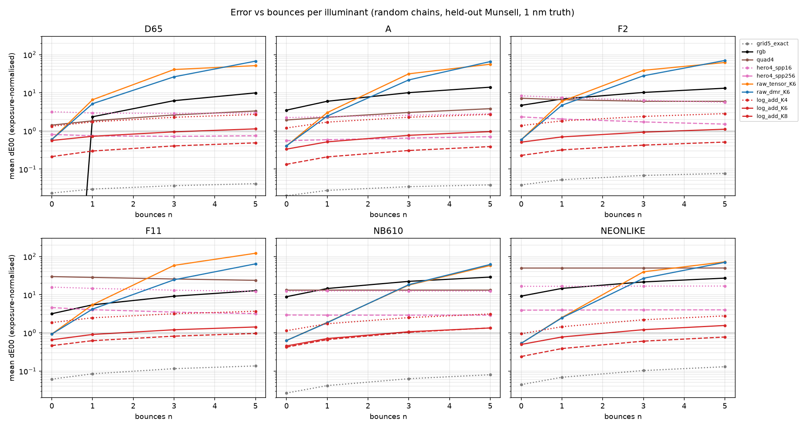
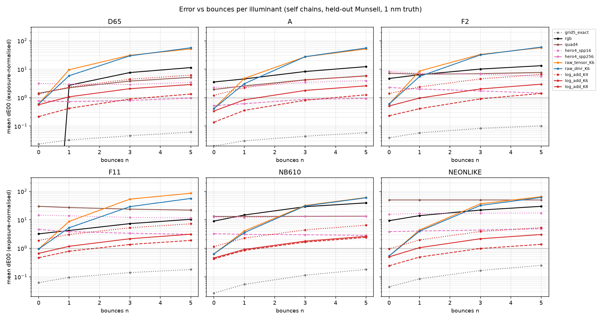

### Intensity sweep through a tonemapper: does RGB "colour purity" collapse?

Display pipeline, identical for truth and every method: XYZ → linear sRGB (D65) → ×s → clip
negatives → **per-channel Reinhard x/(1+x)** → XYZ → CIELAB(D65). 1x means a white reflector
has scene-linear Y = 1.

**Plain answer: no, not in a way that is specific to RGB rendering.** The chroma collapse at
high intensity comes from the **tonemapper**, and it hits the spectral truth just as hard.
Under D65 at 100x, mean display chroma is 4.7 for truth and 4.7 for RGB, against a
scene-linear truth chroma of 104. RGB's displayed chroma is close to the truth's (NB610 at
100x: truth 104.1, RGB 101.1; A at 100x: truth 17.5, RGB 12.1). After tonemapping,
RGB-vs-truth ΔE00 is 1.5–10.4, about the same size as its linear-domain error rather than
larger. The fixed 4λ quadrature does lose purity badly under NEONLIKE (chroma 0.1–7.5 vs truth
77–91), because its 4 wavelengths miss every line. Log-PCA K6 stays ≤ 2.5 ΔE after tonemapping
in all cases. A hue-preserving tonemapper might change these numbers; I tested only the one
stated above.

| case (light / chain / intensity) | C* truth (scene) | C* truth (display) | C* RGB | ΔE RGB | C* fixed 4λ | ΔE fixed 4λ | C* log K6 | ΔE log K6 |
|---|---|---|---|---|---|---|---|---|
| D65, random n=0, 1x | 22.5 | 17.3 | 17.3 | 0.00 | 17.0 | 1.18 | 17.3 | 0.47 |
| D65, random n=0, 10x | 48.4 | 14.0 | 14.0 | 0.00 | 13.6 | 1.01 | 14.0 | 0.36 |
| D65, random n=0, 100x | 104.4 | 4.7 | 4.7 | 0.00 | 4.5 | 0.46 | 4.6 | 0.16 |
| A, random n=0, 1x | 48.6 | 37.3 | 37.8 | 3.01 | 36.6 | 1.52 | 37.4 | 0.30 |
| A, random n=0, 10x | 104.7 | 35.9 | 33.8 | 3.63 | 35.1 | 1.24 | 35.8 | 0.34 |
| A, random n=0, 100x | 225.5 | 17.5 | 12.1 | 4.01 | 16.1 | 0.88 | 17.3 | 0.24 |
| F2, random n=0, 1x | 29.0 | 22.4 | 23.9 | 4.05 | 30.1 | 6.42 | 22.4 | 0.45 |
| F2, random n=0, 10x | 62.6 | 18.9 | 19.1 | 4.03 | 28.7 | 6.91 | 18.8 | 0.40 |
| F2, random n=0, 100x | 134.8 | 7.0 | 6.1 | 2.83 | 12.8 | 3.78 | 7.1 | 0.17 |
| F11, random n=0, 1x | 32.2 | 24.5 | 24.9 | 2.70 | 45.2 | 29.96 | 24.5 | 0.53 |
| F11, random n=0, 10x | 69.4 | 20.2 | 19.9 | 3.01 | 49.8 | 34.04 | 20.2 | 0.45 |
| F11, random n=0, 100x | 149.4 | 7.4 | 6.3 | 2.53 | 27.6 | 20.68 | 7.4 | 0.19 |
| NB610, random n=0, 1x | 130.1 | 82.0 | 78.3 | 2.68 | 75.6 | 3.74 | 82.0 | 0.16 |
| NB610, random n=0, 10x | 302.8 | 100.5 | 96.6 | 2.21 | 98.5 | 1.32 | 100.4 | 0.05 |
| NB610, random n=0, 100x | 664.2 | 104.1 | 101.1 | 1.51 | 103.8 | 0.18 | 104.1 | 0.01 |
| NEONLIKE, random n=0, 1x | 124.8 | 76.9 | 74.0 | 3.80 | 0.1 | 40.01 | 77.0 | 0.52 |
| NEONLIKE, random n=0, 10x | 291.7 | 86.9 | 83.6 | 6.87 | 0.8 | 56.28 | 87.2 | 1.61 |
| NEONLIKE, random n=0, 100x | 638.9 | 90.5 | 86.3 | 10.41 | 7.5 | 77.50 | 91.1 | 2.33 |

Self-chain n=3 rows are in `results/illuminants_tables.md`.

## B. Licence-safe basis

| source | licence (as checked 2026-10-10; not legal advice) | used? |
|---|---|---|
| ECOSTRESS v1.0 | "Copyright © 2017 Caltech. ALL RIGHTS RESERVED"; citation requested | **No: not supplied.** Missing: `data/raw/ecostress/**/*.spectrum.txt`. It would not be shippable without JPL permission anyway. |
| USGS Spectral Library v7 (splib07, DOI 10.5066/F7RR1WDJ) | US Government work, **public domain** per the USGS download information | **No: not fetchable here.** ScienceBase answered with a Cloudflare bot challenge, which I won't bypass. You could download it; I haven't written a loader because I haven't seen its file format. |
| CIE 224:2017 99 colour-evaluation samples (1 nm) | **CC BY-SA 4.0** (CIE metadata). Shipping a basis derived from it likely makes the basis an adaptation, so ship it under CC BY-SA with attribution. Commercial use is allowed | Yes (99 spectra) |
| Synthetic, Jakob–Hanika sigmoid-quadratic (2019) | Generated by us. Jakob & Hanika's *method* is published; the *data* is ours. CIE CMFs/D65 are used as tools | Yes (5000, fitted to colours drawn uniformly from the encoded sRGB cube; LM fit residual < 1e-13 ΔE76) |
| Synthetic, GP-smooth | Generated by us | Yes (5000; parameter ranges are arbitrary choices) |

Overlap check: one CIE 99 sample is within 0.004 RMSE of a Munsell test chip, so there is a
little test contamination for the CIE-99 rows.

### Accuracy on held-out Munsell (Phase 1 metrics: D65, 5 nm; reconstruction mean ΔE00; log-PCA products exposure-normalised n=1/3/5)

| basis trained on | N | raw K4 | raw K6 | raw K8 | log K4 | log K6 | log K8 | log K6 n=1/3/5 (expo) | log K8 n=1/3/5 (expo) |
|---|---|---|---|---|---|---|---|---|---|
| munsell_train (research-only, reference) | 1022 | 1.15 | 0.56 | 0.19 | 1.36 | 0.59 | 0.22 | 0.73 / 0.96 / 1.15 | 0.30 / 0.40 / 0.49 |
| cie99 | 99 | 3.51 | 0.71 | 0.45 | 3.90 | 2.26 | 0.22 | 2.97 / 4.44 / 5.67 | 0.39 / 0.68 / 0.96 |
| synthetic_jh | 5000 | 13.89 | 1.44 | 0.67 | 4.62 | 2.15 | 1.06 | 3.10 / 4.91 / 6.40 | 1.60 / 2.67 / 3.65 |
| synthetic_gp | 5000 | 5.35 | 0.94 | 0.76 | 4.47 | 1.04 | 1.03 | 1.51 / 2.42 / 3.40 | 1.56 / 2.81 / 4.03 |
| synthetic_jh+gp (balanced) | 10000 | 10.08 | 1.07 | 0.68 | 4.95 | 1.30 | 0.97 | 1.94 / 3.16 / 4.34 | 1.44 / 2.56 / 3.64 |
| cie99+jh+gp (balanced) | 10099 | 7.72 | 1.02 | 0.60 | 4.51 | 1.58 | 0.91 | 2.27 / 3.60 / 4.78 | 1.30 / 2.21 / 3.08 |
| cie99+gp (balanced) | 5099 | 3.55 | 0.96 | 0.61 | 3.38 | 1.31 | 0.91 | 1.87 / 2.98 / 3.98 | 1.31 / 2.22 / 3.09 |

"Balanced" means each source gets equal total weight in a weighted PCA, so that 99 measured
spectra are not swamped by 10 000 synthetic ones.

**How much accuracy is lost:**
* **K=6:** the best shippable basis is GP-synthetic (reconstruction 1.04 vs Munsell 0.59;
  products 1.51/2.42/3.40 vs 0.73/0.96/1.15). That's about **2–3x worse**, but still below
  RGB's D65 numbers (2.35/6.22/9.94).
* **K=8:** CIE-99 alone almost matches Munsell (reconstruction 0.22 vs 0.22; products
  0.39/0.68/0.96 vs 0.30/0.40/0.49). But it is erratic at K=6 (2.26), which suggests high
  variance from only 99 samples, and it has the one near-duplicate noted above. I wouldn't
  rely on it without bootstrap checks or a second measured set (USGS).
* **Surprise:** the Jakob–Hanika synthetic set is the weakest source at every K. Its spectra
  all come from a 3-parameter family, so they are lower-dimensional than real spectra.

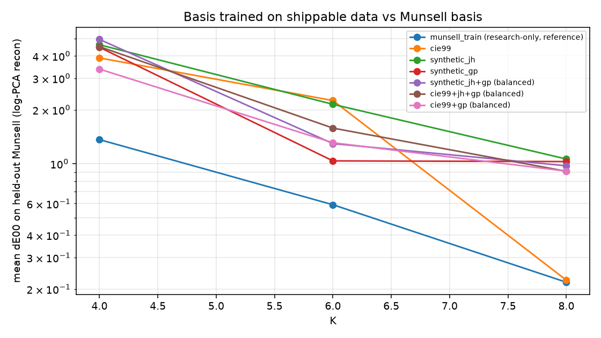

## C. Accumulation cost

Analytic per-path, per-bounce counts (float32; FMA = 2 FLOPs; one emission event per bounce,
NEE-style). CPU timings use vectorised torch on an Intel Family 6 Model 186 with 16 logical
cores, 2^18 paths × 5 bounces, median of 5 runs. **The timings are CPU-only and indicative, not
a GPU prediction.**

| method | path state (B) | fetch/bounce (B) | FLOPs/bounce | exp/bounce | CPU ns per path-bounce (indicative) |
|---|---|---|---|---|---|
| rgb | 24 | 12 | 9 | 0 | 4.6 |
| hero4_jh | 36 | 28 | 52 | 0 | 22.7 |
| logpca_K4 | 32 | 16 | 1303 | 81 | 144.8 |
| logpca_K6 | 40 | 24 | 1629 | 81 | 146.0 |
| hybrid4_K4 | 40 | 32 | 48 | 4 | 41.4 |
| hybrid4_K6 | 48 | 40 | 66 | 4 | 47.2 |

* *Path state* = throughput + radiance accumulator (+ wavelength indices for 4λ, + bounce count
  for log-PCA).
* log-PCA additionally reads 81·(K+1)+243 constant floats per decode (basis, mean, CMF·E).
  These are shared and cache-resident, so they're not counted as per-path traffic.
* *hybrid4* = log-PCA throughput decoded only at the path's 4 wavelengths, with radiance
  accumulated in 4λ space (the variant you suggested).

**Hybrid accuracy** (`results/hybrid4_accuracy.json`, exposure-normalised, n=1/3/5). Hybrid4 K6
at 256 spp: D65 1.07/1.23/1.38 vs hero4 on the true spectra 0.74/0.73/0.75. Under NB610:
3.02/3.12/3.17 vs 2.90/2.94/2.90. It inherits hero4's sampling noise *and* adds PCA bias, so
it is strictly worse than plain hero4.

**Direct answer: yes, the `exp` decode cancels log-PCA's cost case against 4-wavelength
sampling, and there was no real memory advantage to begin with.**
* **Memory:** per-path state is 32 B (K=4) / 40 B (K=6) vs 36 B for hero-4λ, so roughly equal.
  Per-bounce material fetch is 16/24 B vs 28 B, a small win.
* **Compute:** a full decode per emission event is 1303–1629 FLOPs + 81 exp, against 52 FLOPs
  for hero-4λ, i.e. 25–31x the FLOPs. On CPU, 145 vs 23 ns per path-bounce (6.4x).
* **Accumulating in XYZ** with throughput in log-PCA is exactly the `logpca_K*` rows. It still
  needs the full spectral decode, because throughput × light must be formed per wavelength
  before integrating. It is only cheap when emission events are rare, e.g. no NEE, so you
  decode once per path. Then the per-bounce cost is K adds.
* **Accumulating in a fixed or random 4λ space** (hybrid4) is cheap, about 2x hero-4λ on CPU,
  but gives no accuracy benefit, as shown above.
* **What log-PCA buys** is deterministic, noise-free spectral colour per sample. That's worth
  paying for only if very low sample counts matter more than throughput (see the verdict).

## Per-illuminant compact tables (generated: `results/phase15_compact_tables.md`)

**D65**: random chains, mean ΔE00 exposure-normalised [plain], n = 0 / 1 / 3 / 5

| method | n=0 | n=1 | n=3 | n=5 |
|---|---|---|---|---|
| RGB (sRGB/D65) | 0.00 [0.00] | 2.35 [1.66] | 6.22 [1.24] | 9.94 [0.26] |
| fixed 4λ (450/505/560/615) | 1.42 [1.39] | 1.84 [1.31] | 2.62 [0.59] | 3.34 [0.10] |
| hero4, 16 spp, light-agnostic pdf | 3.19 [3.26] | 2.96 [2.17] | 2.87 [0.70] | 2.95 [0.10] |
| hero4, 256 spp, light-agnostic pdf | 0.81 [0.83] | 0.74 [0.54] | 0.72 [0.17] | 0.75 [0.03] |
| linear PCA tensor K=6 | 0.60 [0.56] | 6.59 [3.09] | 40.83 [8.70] | 51.52 [9.43] |
| linear PCA DMR K=4 | 1.18 [1.13] | 7.46 [4.21] | 33.33 [5.04] | 71.87 [2.35] |
| linear PCA DMR K=6 | 0.60 [0.56] | 5.18 [2.74] | 26.25 [2.86] | 67.61 [1.94] |
| linear PCA DMR K=8 | 0.21 [0.19] | 2.65 [1.49] | 28.56 [4.26] | 73.40 [4.45] |
| log PCA K=4 | 1.33 [1.36] | 1.72 [1.27] | 2.28 [0.58] | 2.72 [0.10] |
| log PCA K=6 | 0.56 [0.59] | 0.72 [0.54] | 0.95 [0.23] | 1.13 [0.04] |
| log PCA K=8 | 0.21 [0.21] | 0.30 [0.22] | 0.40 [0.09] | 0.49 [0.01] |
| (5 nm grid, uncompressed) | 0.02 [0.02] | 0.03 [0.02] | 0.04 [0.01] | 0.04 [0.00] |
| hero4, light-aware pdf (1 / 16 / 256 spp), n=1 | 12.27 / 2.87 / 0.72 | | | |

**A**: random chains, mean ΔE00 exposure-normalised [plain], n = 0 / 1 / 3 / 5

| method | n=0 | n=1 | n=3 | n=5 |
|---|---|---|---|---|
| RGB (sRGB/D65) | 3.51 [3.46] | 6.00 [4.24] | 10.09 [2.09] | 14.03 [0.43] |
| fixed 4λ (450/505/560/615) | 1.94 [1.97] | 2.28 [1.64] | 3.05 [0.74] | 3.83 [0.14] |
| hero4, 16 spp, light-agnostic pdf | 2.24 [2.22] | 2.37 [1.71] | 2.57 [0.68] | 2.80 [0.12] |
| hero4, 256 spp, light-agnostic pdf | 0.56 [0.55] | 0.59 [0.43] | 0.65 [0.17] | 0.71 [0.03] |
| linear PCA tensor K=6 | 0.41 [0.39] | 3.03 [1.23] | 31.46 [3.10] | 56.16 [3.58] |
| linear PCA DMR K=4 | 1.34 [1.26] | 4.81 [2.74] | 27.08 [3.95] | 66.68 [2.30] |
| linear PCA DMR K=6 | 0.41 [0.39] | 2.45 [1.14] | 21.76 [2.22] | 65.87 [2.99] |
| linear PCA DMR K=8 | 0.15 [0.14] | 1.48 [0.71] | 19.78 [1.42] | 64.30 [1.41] |
| log PCA K=4 | 1.20 [1.19] | 1.70 [1.23] | 2.29 [0.63] | 2.72 [0.13] |
| log PCA K=6 | 0.33 [0.33] | 0.52 [0.36] | 0.77 [0.19] | 0.96 [0.04] |
| log PCA K=8 | 0.13 [0.12] | 0.21 [0.13] | 0.31 [0.06] | 0.39 [0.01] |
| (5 nm grid, uncompressed) | 0.02 [0.02] | 0.03 [0.02] | 0.03 [0.01] | 0.04 [0.00] |

**F2**: random chains, mean ΔE00 exposure-normalised [plain], n = 0 / 1 / 3 / 5

| method | n=0 | n=1 | n=3 | n=5 |
|---|---|---|---|---|
| RGB (sRGB/D65) | 4.69 [4.62] | 6.88 [5.04] | 10.22 [2.39] | 13.21 [0.46] |
| fixed 4λ (450/505/560/615) | 7.18 [7.10] | 6.62 [4.57] | 5.99 [1.18] | 5.98 [0.16] |
| hero4, 16 spp, light-agnostic pdf | 8.36 [8.34] | 7.52 [5.28] | 6.34 [1.25] | 5.66 [0.14] |
| hero4, 256 spp, light-agnostic pdf | 2.34 [2.33] | 2.05 [1.43] | 1.72 [0.34] | 1.51 [0.04] |
| linear PCA tensor K=6 | 0.59 [0.53] | 5.98 [2.53] | 38.88 [6.23] | 62.30 [6.89] |
| linear PCA DMR K=4 | 1.54 [1.41] | 6.61 [3.55] | 28.53 [3.63] | 65.97 [1.90] |
| linear PCA DMR K=6 | 0.59 [0.53] | 4.73 [2.31] | 27.93 [3.41] | 70.52 [3.43] |
| linear PCA DMR K=8 | 0.33 [0.30] | 1.84 [0.99] | 21.51 [1.80] | 66.86 [1.28] |
| log PCA K=4 | 1.38 [1.36] | 1.84 [1.33] | 2.40 [0.60] | 2.85 [0.10] |
| log PCA K=6 | 0.51 [0.51] | 0.70 [0.50] | 0.93 [0.21] | 1.11 [0.03] |
| log PCA K=8 | 0.23 [0.22] | 0.32 [0.22] | 0.42 [0.10] | 0.51 [0.02] |
| (5 nm grid, uncompressed) | 0.04 [0.04] | 0.05 [0.03] | 0.07 [0.01] | 0.08 [0.00] |

**F11**: random chains, mean ΔE00 exposure-normalised [plain], n = 0 / 1 / 3 / 5

| method | n=0 | n=1 | n=3 | n=5 |
|---|---|---|---|---|
| RGB (sRGB/D65) | 3.17 [3.08] | 5.43 [3.80] | 9.14 [1.84] | 12.75 [0.36] |
| fixed 4λ (450/505/560/615) | 29.84 [30.79] | 28.41 [20.96] | 25.81 [5.51] | 23.83 [0.63] |
| hero4, 16 spp, light-agnostic pdf | 15.82 [15.91] | 14.64 [10.69] | 13.13 [3.35] | 12.26 [0.50] |
| hero4, 256 spp, light-agnostic pdf | 4.59 [4.59] | 4.04 [2.92] | 3.49 [0.87] | 3.19 [0.12] |
| linear PCA tensor K=6 | 0.93 [0.85] | 5.46 [2.15] | 58.72 [4.48] | 122.09 [5.14] |
| linear PCA DMR K=4 | 2.06 [1.95] | 7.10 [4.04] | 27.94 [4.01] | 61.05 [1.53] |
| linear PCA DMR K=6 | 0.93 [0.85] | 4.19 [2.09] | 24.58 [3.46] | 64.41 [3.14] |
| linear PCA DMR K=8 | 0.70 [0.64] | 3.15 [1.73] | 25.85 [3.09] | 70.64 [1.92] |
| log PCA K=4 | 1.86 [1.83] | 2.48 [1.79] | 3.17 [0.83] | 3.68 [0.15] |
| log PCA K=6 | 0.66 [0.63] | 0.91 [0.59] | 1.20 [0.26] | 1.43 [0.05] |
| log PCA K=8 | 0.46 [0.44] | 0.62 [0.41] | 0.82 [0.17] | 0.97 [0.03] |
| (5 nm grid, uncompressed) | 0.06 [0.06] | 0.08 [0.06] | 0.11 [0.03] | 0.14 [0.01] |
| hero4, light-aware pdf (1 / 16 / 256 spp), n=1 | 10.99 / 2.96 / 0.74 | | | |

**NB610**: random chains, mean ΔE00 exposure-normalised [plain], n = 0 / 1 / 3 / 5

| method | n=0 | n=1 | n=3 | n=5 |
|---|---|---|---|---|
| RGB (sRGB/D65) | 8.87 [7.77] | 14.54 [6.86] | 22.37 [3.35] | 28.96 [0.85] |
| fixed 4λ (450/505/560/615) | 13.18 [12.88] | 13.19 [8.40] | 13.18 [3.27] | 13.19 [0.72] |
| hero4, 16 spp, light-agnostic pdf | 12.44 [12.37] | 12.57 [8.62] | 12.56 [3.91] | 12.43 [0.95] |
| hero4, 256 spp, light-agnostic pdf | 2.94 [2.63] | 2.91 [1.86] | 2.90 [0.90] | 2.92 [0.24] |
| linear PCA tensor K=6 | 0.63 [0.51] | 1.88 [0.95] | 17.82 [4.23] | 58.34 [6.83] |
| linear PCA DMR K=4 | 1.38 [1.10] | 3.13 [1.67] | 11.71 [2.57] | 29.22 [1.42] |
| linear PCA DMR K=6 | 0.63 [0.51] | 1.85 [0.94] | 18.29 [4.42] | 62.08 [8.40] |
| linear PCA DMR K=8 | 0.69 [0.54] | 4.69 [2.22] | 35.48 [6.38] | 48.47 [2.13] |
| log PCA K=4 | 1.14 [1.00] | 1.73 [1.07] | 2.51 [0.76] | 3.13 [0.24] |
| log PCA K=6 | 0.45 [0.40] | 0.71 [0.44] | 1.07 [0.33] | 1.34 [0.10] |
| log PCA K=8 | 0.42 [0.36] | 0.66 [0.39] | 1.04 [0.30] | 1.35 [0.09] |
| (5 nm grid, uncompressed) | 0.03 [0.02] | 0.04 [0.02] | 0.06 [0.02] | 0.08 [0.01] |
| hero4, light-aware pdf (1 / 16 / 256 spp), n=1 | 0.42 / 0.10 / 0.02 | | | |

**NEONLIKE**: random chains, mean ΔE00 exposure-normalised [plain], n = 0 / 1 / 3 / 5

| method | n=0 | n=1 | n=3 | n=5 |
|---|---|---|---|---|
| RGB (sRGB/D65) | 9.18 [8.43] | 14.64 [7.65] | 21.62 [3.60] | 27.21 [0.83] |
| fixed 4λ (450/505/560/615) | 49.93 [55.79] | 49.94 [34.07] | 49.97 [12.26] | 50.01 [2.31] |
| hero4, 16 spp, light-agnostic pdf | 16.60 [16.70] | 16.63 [11.84] | 16.78 [5.28] | 16.86 [1.25] |
| hero4, 256 spp, light-agnostic pdf | 3.93 [3.69] | 3.96 [2.68] | 4.00 [1.25] | 4.01 [0.31] |
| linear PCA tensor K=6 | 0.53 [0.48] | 2.53 [1.39] | 39.78 [7.50] | 72.68 [9.98] |
| linear PCA DMR K=4 | 1.11 [0.97] | 3.42 [2.03] | 22.81 [4.14] | 61.74 [2.52] |
| linear PCA DMR K=6 | 0.53 [0.48] | 2.48 [1.37] | 26.93 [4.07] | 70.61 [3.92] |
| linear PCA DMR K=8 | 0.27 [0.24] | 0.77 [0.47] | 13.29 [3.09] | 55.35 [6.05] |
| log PCA K=4 | 0.94 [0.86] | 1.45 [0.95] | 2.20 [0.74] | 2.79 [0.23] |
| log PCA K=6 | 0.50 [0.47] | 0.78 [0.54] | 1.21 [0.42] | 1.56 [0.13] |
| log PCA K=8 | 0.24 [0.22] | 0.39 [0.25] | 0.61 [0.19] | 0.78 [0.06] |
| (5 nm grid, uncompressed) | 0.04 [0.04] | 0.07 [0.04] | 0.10 [0.02] | 0.13 [0.00] |
| hero4, light-aware pdf (1 / 16 / 256 spp), n=1 | 3.77 / 0.85 / 0.22 | | | |

---

# Phase 2 (2026-10-10): tonemapper control, CPU reference, WebGPU RGB vs hero-4λ

## Task 0: tonemapper check

**Formulas** (`src/tonemap.py`; the identical WGSL is in `src/webgpu/display.wgsl`). Input is scene-linear sRGB (D65 white) after exposure:
* **per-channel Reinhard** (Phase 1.5): y_c = x_c⁺ / (1 + x_c⁺), x⁺ = max(x, 0).
* **max-RGB (hue-preserving)**: x⁺ = max(x, 0); m = max_c x⁺_c; y = x⁺ · (m/(1+m)) / m = x⁺ / (1+m).
  Channel *ratios* are kept exactly. Out-of-gamut input is handled only by the negative clip.
* **Oklch (chroma-preserving)**: Y = luminance(x); Y′ = Y/(1+Y); (L, C, h) = Oklch(x) with a signed cube
  root; L′ = Y′^(1/3); C′ = C·L′/L; back to linear sRGB; if outside [0,1]³, C′ is reduced by
  bisection at constant L′ and h. Oklab is Ottosson (2020); the constants are verified against
  colour-science and against the numerical inverse in tests.

Same samples as Phase 1.5 (held-out Munsell, 1 nm truth). Chroma is CIELAB C*ab with the D65
white. |Δh| is the mean absolute hue difference from the **scene-linear** truth hue, for samples
with scene chroma > 10. Full table (1x/10x/100x, both chain types): `results/tonemap_check_table.md`.

| light | samples | intensity | tonemap | C* truth | C* RGB | RGB/truth chroma | |Δh| truth (°) | |Δh| RGB (°) | ΔE00 RGB vs truth |
|---|---|---|---|---|---|---|---|---|---|
| D65 | single | 1x | reinhard_channel | 16.5 | 16.5 | 1.00 | 2.1 | 2.1 | 0.00 |
| D65 | single | 1x | maxrgb | 18.9 | 18.9 | 1.00 | 0.0 | 0.0 | 0.00 |
| D65 | single | 1x | oklch | 19.4 | 19.4 | 1.00 | 0.0 | 0.0 | 0.00 |
| D65 | single | 100x | reinhard_channel | 5.3 | 5.3 | 1.00 | 12.2 | 12.2 | 0.00 |
| D65 | single | 100x | maxrgb | 31.0 | 31.0 | 1.00 | 0.0 | 0.0 | 0.00 |
| D65 | single | 100x | oklch | 6.8 | 6.8 | 1.00 | 1.9 | 1.9 | 0.00 |
| D65 | self | 1x | reinhard_channel | 15.0 | 15.9 | 1.06 | 2.9 | 7.0 | 1.72 |
| D65 | self | 1x | maxrgb | 15.2 | 16.3 | 1.07 | 2.9 | 7.8 | 1.72 |
| D65 | self | 1x | oklch | 14.0 | 16.3 | 1.17 | 1.8 | 7.8 | 2.37 |
| D65 | self | 100x | reinhard_channel | 39.9 | 36.4 | 0.91 | 16.4 | 11.4 | 4.07 |
| D65 | self | 100x | maxrgb | 48.8 | 49.7 | 1.02 | 4.9 | 8.5 | 3.56 |
| D65 | self | 100x | oklch | 32.2 | 32.5 | 1.01 | 5.3 | 8.7 | 4.32 |
| NB610 | single | 1x | reinhard_channel | 81.7 | 78.1 | 0.96 | 7.6 | 9.1 | 2.57 |
| NB610 | single | 1x | maxrgb | 81.7 | 78.1 | 0.96 | 7.6 | 9.1 | 2.57 |
| NB610 | single | 1x | oklch | 75.5 | 67.8 | 0.90 | 6.5 | 10.0 | 5.18 |
| NB610 | single | 100x | reinhard_channel | 104.1 | 100.8 | 0.97 | 7.2 | 8.3 | 1.63 |
| NB610 | single | 100x | maxrgb | 104.1 | 100.8 | 0.97 | 7.2 | 8.3 | 1.63 |
| NB610 | single | 100x | oklch | 3.5 | 6.1 | 1.74 | 10.7 | 13.2 | 5.14 |
| NB610 | self | 1x | reinhard_channel | 28.3 | 29.8 | 1.05 | 3.5 | 4.1 | 2.28 |
| NB610 | self | 1x | maxrgb | 28.3 | 29.8 | 1.05 | 3.5 | 4.1 | 2.28 |
| NB610 | self | 1x | oklch | 26.9 | 28.0 | 1.04 | 2.1 | 7.1 | 3.96 |
| NB610 | self | 100x | reinhard_channel | 70.6 | 67.8 | 0.96 | 8.8 | 8.7 | 3.67 |
| NB610 | self | 100x | maxrgb | 70.6 | 67.8 | 0.96 | 8.8 | 8.7 | 3.67 |
| NB610 | self | 100x | oklch | 31.4 | 23.8 | 0.76 | 9.6 | 12.9 | 8.67 |
| NEONLIKE | single | 1x | reinhard_channel | 75.7 | 73.3 | 0.97 | 6.6 | 10.6 | 3.86 |
| NEONLIKE | single | 1x | maxrgb | 77.8 | 75.1 | 0.97 | 8.6 | 12.2 | 3.35 |
| NEONLIKE | single | 1x | oklch | 74.1 | 67.7 | 0.91 | 5.9 | 11.1 | 5.71 |
| NEONLIKE | single | 100x | reinhard_channel | 90.1 | 86.1 | 0.95 | 30.7 | 36.3 | 10.26 |
| NEONLIKE | single | 100x | maxrgb | 101.3 | 100.8 | 0.99 | 8.2 | 11.5 | 4.10 |
| NEONLIKE | single | 100x | oklch | 3.8 | 6.9 | 1.83 | 9.7 | 13.9 | 4.11 |
| NEONLIKE | self | 1x | reinhard_channel | 27.0 | 28.4 | 1.05 | 4.3 | 7.4 | 2.64 |
| NEONLIKE | self | 1x | maxrgb | 27.3 | 28.6 | 1.05 | 4.9 | 7.8 | 2.59 |
| NEONLIKE | self | 1x | oklch | 25.4 | 27.5 | 1.08 | 2.2 | 11.4 | 4.31 |
| NEONLIKE | self | 100x | reinhard_channel | 64.1 | 63.6 | 0.99 | 22.5 | 20.7 | 8.75 |
| NEONLIKE | self | 100x | maxrgb | 68.6 | 68.5 | 1.00 | 9.3 | 11.6 | 6.24 |
| NEONLIKE | self | 100x | oklch | 30.2 | 27.8 | 0.92 | 9.1 | 16.0 | 9.03 |

**Plain answer: once the tonemapper is controlled for, there is no RGB-specific loss of colour
purity.** With the hue-preserving max-RGB operator, RGB's displayed chroma is 0.96–1.07x the
spectral truth's in every case tested (D65, the 610 nm line and neon-like; 1x/10x/100x). What
remains is ordinary colour error:
* **hue:** RGB's mean hue error relative to the scene truth is up to 4.9° larger than the truth's own
  display hue error (D65 self-products: 7.8° vs 2.9°; neon-like: up to +3.6°; one 610 nm case:
  0.3° smaller);
* **total:** ΔE00 RGB vs truth after max-RGB tonemapping is 0 (D65 single surfaces, exact by
  construction) to 6.2 (neon-like self-products at 100x).

The tonemappers themselves differ a lot:
* **Per-channel Reinhard** shifts hue (|Δh| up to 31° for neon-like at 100x) and desaturates.
* **max-RGB** keeps hue (0° under D65) and keeps chroma.
* **Oklch** keeps hue but must drop chroma at high luminance (C* falls to 3–7 at 100x for both
  truth and RGB), because bright saturated colours do not fit the display gamut near white.
* Under the 610 nm line, even the truth shows |Δh| ≈ 7° with max-RGB. That comes from clipping
  the out-of-gamut negative channels, not from RGB rendering.

**max-RGB is now the default display tonemap** (Phase 2 harness and demo).

## Phase 2 setup (all run and verified on this machine, 2026-10-10)

* **Scene**: Cornell-like box, all Lambertian. Walls and spheres use **measured** CIE 224:2017 CES
  spectra (CC BY-SA 4.0): white, red, green, blue, yellow, magenta. One quad light, three spheres.
  Three light variants: CIE D65, CIE F11, and a synthetic 610 nm line (FWHM 5 nm). Integrator:
  ≤ 5 scattering vertices, NEE, no Russian roulette. It is identical on CPU and GPU.
* **CPU reference** (`src/cpu_reference/`, Python + Numba): 1 nm spectral, 8192 spp, 512². Tests
  passed: white furnace (exact), analytic point-to-rectangle form factor (NEE within 0.5%), NEE
  vs pure path tracing, sampled vs full 401-wavelength integration. Half-split noise is 0.004–0.005
  relative to white.
* **WebGPU** (`src/webgpu/`, WGSL + plain JS). Modes:
  * **RGB**: sRGB albedo under D65; light = linear sRGB of its XYZ, negatives kept.
  * **hero-4λ**: Wilkie et al. 2014, with a Jakob & Hanika 2019 sigmoid-polynomial uplift of the same
    sRGB albedo (own 32³ LUT generator; the BSD-3 `rgb2spec` was not used) and light-aware wavelength
    sampling with pdf ∝ (x̄+ȳ+z̄)·E. These are known techniques; Peters' 2025 tracer does the same (see SURVEY.md).
  * **measured-spectra validation** mode: the GPU path tracer fed the true spectra, to test the
    renderer itself.
* **GPU used: Intel integrated GPU (Chrome adapter `intel / gen-12lp`). The RTX 4060 was NOT
  measured.** Chrome ignored `powerPreference: "high-performance"`. Switching needs a Windows
  graphics setting, which I did not change (see NEXT_STEPS.md).
* **Metrics**: mean CIEDE2000 and RMSE (XYZ, white = 1) vs the CPU reference. Same exposure
  everywhere (reference median Y → 18). Emitter and background-miss pixels are excluded. Frame time is
  the GPU timestamp-query sum over dispatches, as a median (min–max) of 5 identical renders. Memory is
  the bytes of buffers each mode reads.

### Suspicious 1024-spp number (nb610 RGB: 32.573): investigation

* **Not reproducible.** The saved run (22:38) and three fresh runs all give **3.770** at 1024 spp
  (Python recomputation from the saved image agrees to 3 decimals), with every pixel's sample count
  correct and no device loss.
* The browser reference files are byte-identical to the converged `.npz` files.
* The value appears in no saved file. Renders are deterministic, and the 1–64 spp values you quoted
  match exactly, so it came from a run whose 1024-spp output was later overwritten.
* The server log shows four benchmark runs. The 21:31 run was the only one made while the CPU
  references were still rendering. It stopped at F11 (that reference did not exist yet) without saving.
  The nb610 reference had been final since 21:28, so a placeholder reference is unlikely.
  **Root cause: not determined.**
* Hypotheses checked:

| hypothesis | finding |
|---|---|
| unfinished/placeholder reference | ruled out for every run after 21:28; the harness now refuses references without metadata reporting ≥ 8192 spp at full resolution |
| float32 accumulation / overflow | ruled out at 1024 spp (finite values, correct counts, matches Python) |
| RNG seed reuse/correlation | **real flaw found, but it cannot cause a 10x error.** XOR seeding made 27 of 1024 samples reuse pixel-permuted streams (correlated noise across pixels, no bias). Fixed with an injective seed; test added |
| exposure/tonemap mismatch | ruled out (same exposure code path; Python recomputation agrees) |
| harness bug at high spp (buffers, loops, timeouts) | not reproduced. Guards added: per-pixel sample count must equal spp, abort on device loss, reference validation |

* **All earlier benchmark numbers are discarded**; the tables below are from the clean run after these fixes.
* The fix also changed one metric: background-miss pixels (13.6% of the image, black in both) used
  to be counted, which diluted the means; they are now excluded.

### Accuracy vs spp (Intel iGPU run; full JSON/CSV: `results/phase2_benchmark_intel_igpu.{json,csv}`)

**cornell_d65**: mean ΔE00 / RMSE vs CPU reference (emitter and background pixels excluded)

| mode | 1 spp | 4 spp | 16 spp | 64 spp |
|---|---|---|---|---|
| RGB | 12.88 / 0.4976 | 7.24 / 0.2245 | 3.77 / 0.1233 | 1.97 / 0.0595 |
| hero-4λ + J&H uplift | 18.27 / 0.5192 | 10.65 / 0.2566 | 5.76 / 0.1300 | 3.00 / 0.0699 |
| hero-4λ, measured spectra (validation) | 17.80 / 0.5191 | 10.61 / 0.2565 | 5.76 / 0.1300 | 2.97 / 0.0699 |

**cornell_nb610**: mean ΔE00 / RMSE vs CPU reference (emitter and background pixels excluded)

| mode | 1 spp | 4 spp | 16 spp | 64 spp |
|---|---|---|---|---|
| RGB | 13.15 / 0.5070 | 7.89 / 0.2405 | 5.65 / 0.1364 | 4.77 / 0.0899 |
| hero-4λ + J&H uplift | 11.02 / 0.5624 | 5.29 / 0.2776 | 2.72 / 0.1441 | 1.53 / 0.0777 |
| hero-4λ, measured spectra (validation) | 10.93 / 0.5623 | 5.14 / 0.2774 | 2.52 / 0.1437 | 1.25 / 0.0770 |

**cornell_f11**: mean ΔE00 / RMSE vs CPU reference (emitter and background pixels excluded)

| mode | 1 spp | 4 spp | 16 spp | 64 spp |
|---|---|---|---|---|
| RGB | 12.90 / 0.4156 | 7.46 / 0.1927 | 4.52 / 0.1026 | 3.24 / 0.0581 |
| hero-4λ + J&H uplift | 17.33 / 0.4786 | 10.10 / 0.2346 | 5.64 / 0.1220 | 3.34 / 0.0651 |
| hero-4λ, measured spectra (validation) | 17.48 / 0.4781 | 10.08 / 0.2342 | 5.34 / 0.1218 | 2.72 / 0.0649 |

**Converged GPU renders (1024 spp, image-only, not timed)**: mean ΔE00 / RMSE vs reference. These show bias, not noise.

| scene | RGB | hero-4λ + J&H | hero-4λ, measured spectra (validation) |
|---|---|---|---|
| D65 | 0.74 / 0.0151 | 0.95 / 0.0164 | 0.78 / 0.0163 |
| 610 nm line | **4.37 / 0.0607** | 0.80 / 0.0197 | 0.33 / 0.0166 |
| F11 | **2.58 / 0.0192** | 1.91 / 0.0148 | 0.71 / 0.0141 |

* **Renderer validation:** the measured-spectra mode converges to the CPU reference (0.33–0.78 at
  1024 spp, still falling with spp), so the GPU path tracer agrees with the independent CPU code.
* **Uplift error:** the gap between hero-4λ + J&H and measured spectra is the Jakob–Hanika uplift error.
  It is small under D65 (0.17) but large under F11 (1.20), where the blue, red and magenta materials
  reach 3.5–3.9 per surface. The uplift only matches colour under D65; under a spiky light the guessed
  spectrum's metamerism shows.

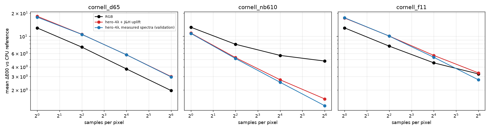

### Frame time and memory (Intel iGPU `gen-12lp`; RTX 4060 not measured)

GPU ms per frame at N spp (median of 5; hero-4λ overhead over RGB in brackets):

| scene | 1 spp RGB / hero-4λ | 4 spp | 16 spp | 64 spp |
|---|---|---|---|---|
| D65 | 5.8 / 9.2 (+58%) | 11.1 / 18.7 (+69%) | 45.9 / 60.6 (+32%) | 175.4 / 234.5 (+34%) |
| 610 nm | 4.7 / 8.7 (+85%) | 13.0 / 17.2 (+32%) | 44.3 / 59.8 (+35%) | 182.4 / 225.3 (+24%) |
| F11 | 6.9 / 7.1 (+3%) | 15.0 / 18.9 (+26%) | 45.5 / 60.4 (+33%) | 178.6 / 231.8 (+30%) |

* **Steady-state overhead** (16–64 spp, where timing is stable) is **+24% to +35%**: about 2.8 ms/spp
  for RGB vs 3.6 ms/spp for hero-4λ at 512².
* At 1–4 spp the iGPU timings are noisy: the min–max ranges in `results/phase2/phase2_tables.md`
  span up to 3x, so the 1-spp percentages are unreliable.
* **Memory:** RGB mode reads 4,195,008 B; hero-4λ + J&H reads 4,732,128 B (**+537,120 B, +12.8%**).
  Almost all of that is the 32³ coefficient LUT (524,288 B), plus 401-entry CMF and light tables.
  The per-pixel accumulation buffer is the same (16 B/px).
* Caveat: one shared kernel with a uniform mode branch. RGB mode still carries 4-lane throughput
  (one unused lane), so a dedicated RGB kernel might be slightly faster than measured.

### Where RGB fails: mean ΔE00 per first-hit surface (1024 spp, converged)

| scene | mode | white | red | green | blue | yellow | magenta |
|---|---|---|---|---|---|---|---|
| D65 | RGB | 0.93 | 0.39 | 0.41 | 1.32 | 0.98 | 0.64 |
| D65 | hero-4λ + J&H | 1.21 | 0.65 | 0.48 | 1.16 | 0.75 | 1.07 |
| D65 | measured (validation) | 1.08 | 0.33 | 0.44 | 0.52 | 0.67 | 0.55 |
| 610 nm | RGB | 1.71 | **9.85** | **4.88** | **9.18** | **6.55** | 3.76 |
| 610 nm | hero-4λ + J&H | 0.41 | 1.37 | 0.60 | 3.61 | 0.54 | 1.57 |
| 610 nm | measured (validation) | 0.36 | 0.25 | 0.22 | 0.21 | 0.43 | 0.47 |
| F11 | RGB | 1.75 | 2.90 | 2.52 | **10.21** | 4.05 | 3.45 |
| F11 | hero-4λ + J&H | 1.53 | 3.45 | 0.97 | 3.92 | 0.99 | 3.75 |
| F11 | measured (validation) | 0.91 | 0.32 | 0.54 | 0.56 | 0.73 | 0.50 |

### Side-by-side images (max-RGB hue-preserving tonemap, same exposure; bottom row = ΔE00 maps)

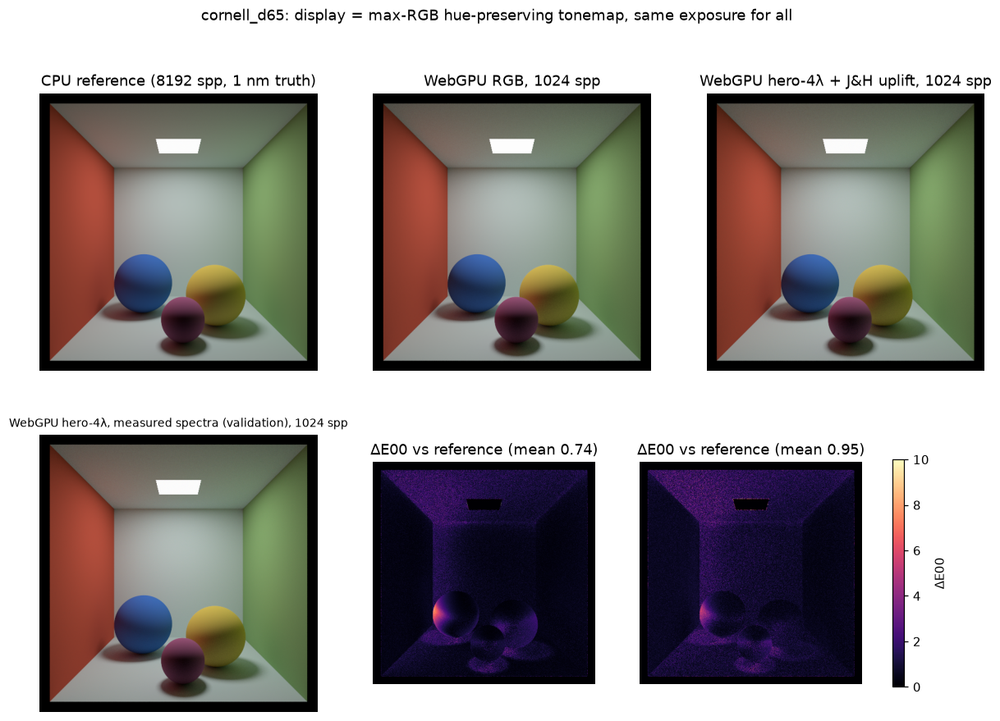
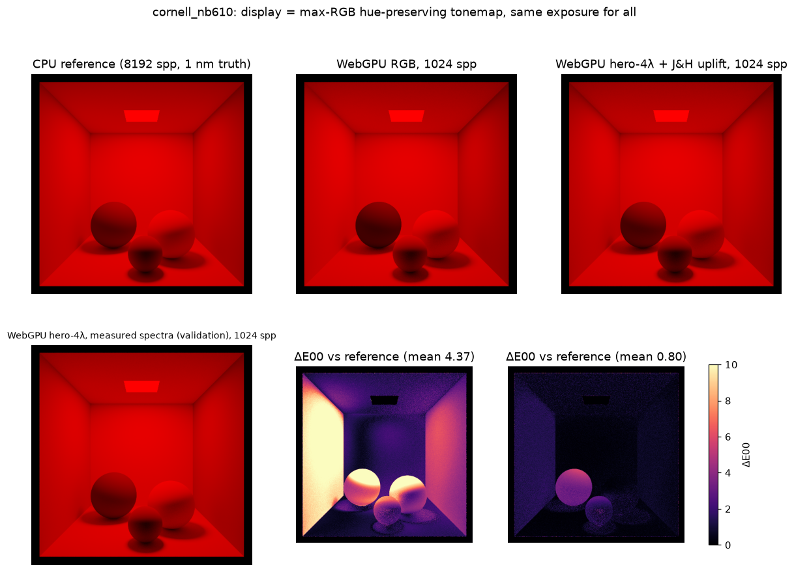
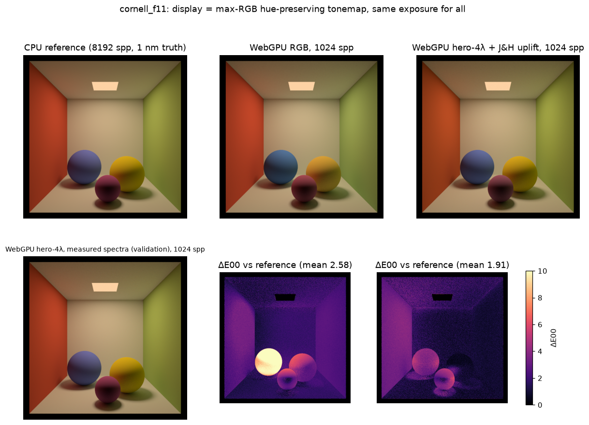

64-spp versions: `results/figures/phase2_<scene>_compare_64spp.png`.

**What the images show:**
* **F11:** RGB is visibly wrong. The blue sphere turns cyan-blue (the reference is violet-blue) and the
  yellow sphere shifts toward orange. Hero-4λ + J&H is much closer but not perfect: the blue sphere is
  slightly off, and the red wall and magenta sphere show uplift error in the ΔE map.
* **610 nm line:** every image is monochrome red, so RGB cannot show a *hue* error. Its error is in
  *lightness*: the red wall, blue sphere and yellow sphere are too bright or too dark. This is visible
  side by side but subtle; the ΔE map (≥ 10 on those surfaces) shows it far more clearly than the image.
* **D65:** no visible difference between any of the modes.

### Noise at low spp (equal spp)

* **Broadband lights:** hero-4λ is noisier than RGB at equal spp. Under D65, ΔE00 is 18.3 vs 12.9
  at 1 spp and 10.7 vs 7.2 at 4 spp; under F11, 17.3 vs 12.9 and 10.1 vs 7.5. RMSE differs much less
  (0.519 vs 0.498 at 1 spp under D65), so the extra noise is mostly **chroma** noise from wavelength
  sampling.
* **610 nm line:** hero-4λ is *better* already at 1 spp (11.0 vs 13.2), because light-aware sampling
  makes the spectral estimate nearly noise-free for a single line, while RGB is biased.
* **Crossover:** at 64 spp, hero-4λ beats RGB clearly under the 610 nm line (1.53 vs 4.77), roughly
  ties under F11 (3.34 vs 3.24), and is worse under D65 (3.00 vs 1.97), where RGB has almost no bias.

### Run and verified here vs. still to run on your machine

* **Run and verified here:**
  * Task 0 tonemap check.
  * CPU reference and its tests.
  * WGSL compilation (Chrome, no messages).
  * Python and Node tests.
  * The full benchmark (3 scenes × 3 modes × 1/4/16/64 spp × 5 timing repeats) on the **Intel iGPU**.
  * Per-surface table and images.
* **Not run here / must be run on your machine:**
  * Any **RTX 4060** (or other discrete GPU) timing. Chrome must be switched to the high-performance
    GPU; see NEXT_STEPS.md.
  * Runs in other browsers.
